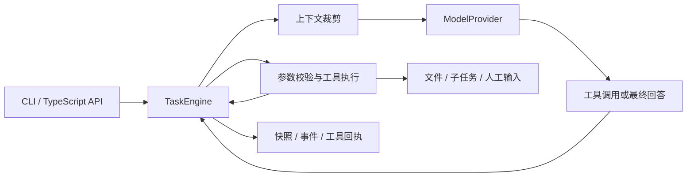

# TaskWeave · 织程

**把目标织成任务，把任务落成产物。**

TaskWeave 是一个用 TypeScript 实现的任务型 Agent。需求分析、测试设计、文档生成和代码修改共享同一套执行内核：模型选择工具，执行器校验参数、保存检查点、执行工具，再把结果反馈给模型。

当前版本为 **v0.1.0-alpha.1**，入口是本地 CLI。代码任务可以生成、修改文本文件；测试任务可以生成测试计划和测试代码。本版没有 Shell 执行器，不会替你运行生成的代码或测试。

## 快速体验

需要 Node.js **20.19+**、npm。无需构建，无需启动服务。

```bash
npm ci
npm run demo
```

演示会在 `.demo/` 中生成一份需求文档，以及两个带验收标准的待执行子任务。stdout 显示结果，stderr 显示执行事件。

**`--demo` 使用固定脚本和模板，不调用模型，不代表真实模型的推理效果。** 它与真实模式使用相同的工具、执行循环和持久化机制，适合快速检查安装和任务链路。

```bash
# 查看任务 ID 和状态
npm start -- list --workspace .demo

# 查看某个任务、产物和事件，将 <task-id> 替换为实际 ID
npm start -- show <task-id> --workspace .demo
npm start -- events <task-id> --workspace .demo --after 1

# 执行上一步创建的一个子任务；演示任务恢复时也需要 --demo
npm start -- resume <child-task-id> --demo --workspace .demo
```

## 接入真实模型

适配器使用支持 function tools 的 Chat Completions 接口。`TASKWEAVE_BASE_URL` 应是 API 根地址，程序会追加 `/chat/completions`。模型需要支持 `tool_choice: auto` 和工具结果消息；不同供应商仍需分别验证兼容性。

将 `.env.example` 复制成 `.env`，填写自己的地址、模型名称和密钥：

```dotenv
TASKWEAVE_BASE_URL=https://api.deepseek.com/v1
TASKWEAVE_MODEL=deepseek-flash
TASKWEAVE_API_KEY=your-key
```

```bash
node --env-file=.env bin/taskweave.mjs run \
  --kind requirements \
  --prompt "设计一个团队待办应用，明确角色、状态流转和验收标准；生成需求文档与开发、测试子任务" \
  --workspace work
```

也可以通过 shell 导出同名环境变量后使用 `npm start -- run ...`。CLI **不会自动读取工作目录中的 `.env`**，只有显式传给 Node 的文件才会被加载。密钥只从调用进程的环境读取，不写入任务快照。

工作区文件的片段会随工具结果发送给你配置的模型服务，请选择适合这些资料的服务和工作目录。

## 任务类型

| `--kind` | 用途 | 典型输出 |
| --- | --- | --- |
| `requirements` | 分析目标、范围、角色与业务规则 | 需求文档、验收标准、开发与测试子任务 |
| `tests` | 根据需求或源码设计测试 | 测试计划、用例、测试代码、补充任务 |
| `document` | 根据真实资料生成或更新文档 | README、设计说明、接口文档 |
| `code` | 阅读、定位、生成或修改代码 | 文本文件变更、变更说明 |
| `general` | 综合处理其他文件任务 | 文档、文件、后续任务 |

任务类型提供不同的系统指令，并不预设固定工具调用步骤。真实模式下的产物由模型决定。`create_task` 创建的是结构化待办，子任务**不会自动调度**；可以查看后用 `resume` 单独执行。

## CLI

```text
run     --prompt <目标> [--kind general] [--workspace <目录>]
resume  <任务ID> [--answer <补充信息>] [--workspace <目录>]
list    [--workspace <目录>]
show    <任务ID> [--workspace <目录>]
events  <任务ID> [--after <序号>] [--workspace <目录>]
unlock  [--workspace <目录>]
```

`run` / `resume` 支持 `--demo`、`--max-steps`、`--timeout`；所有命令支持 `--json`。完整参数见 `npm start -- --help`。

- 模型调用上限默认 24 次，最大 200 次，失败请求也计入步数；恢复时可以提高上限。
- 单次运行时限默认 300 秒，最大 3,600 秒；Ctrl+C 会取消执行并保存检查点。
- `ask_user` 会把任务置为 `waiting_input`。执行 `resume <id> --answer "补充信息"` 后继续同一任务。
- 暂停、取消、失败、达到步数上限后的任务可以恢复；已完成的任务不重复执行。
- 恢复需要相同的工作目录和模型配置；更换密钥可以，但 API 根地址和模型名称必须一致。
- 退出码：完成或等待输入为 `0`，错误或预算耗尽为 `1`，取消为 `130`。自动化调用还应检查 JSON 中的 `status`。

## 核心实现



核心执行循环没有依赖 Agent 编排框架。运行时依赖仅 `tsx`，用来直接运行 TypeScript 源文件。

| 工具 | 行为 |
| --- | --- |
| `list_files` | 有上限地列出工作区普通文件 |
| `read_file` | 按行读取文本，同时返回完整文件的 SHA-256 |
| `search_files` | 不区分大小写的字面量搜索，返回路径、行号和片段 |
| `write_file` | 新建或更新文本，检查预期内容 hash，并以同目录临时文件替换 |
| `create_task` | 创建包含类型、目标、验收标准的子任务 |
| `ask_user` | 保存问题并暂停，等待外部补充输入 |

状态保存在所选工作目录中：

```text
work/
├── artifacts/                 # 约定的文档产物目录，模型也可写其他允许路径
└── .taskweave/
    ├── tasks/<id>.json         # 完整对话、状态、预算、待处理工具调用
    ├── events/<id>.jsonl       # 带单调递增序号的事件
    ├── receipts/*.json         # 工具结果回执，用于中断恢复
    └── run.lock               # 运行期间的工作区互斥锁
```

恢复时先处理检查点里的待执行工具调用。已保存回执的调用直接复用结果；回执未落盘时，重复写入相同内容不会再次改写文件，子任务通过稳定 ID 防止重复创建。事件用于观察和诊断，**没有实现从事件日志独立重建所有状态**。

工作区锁串行化同一工作区内的 TaskWeave 写入。强制终止可能留下锁；`unlock` 仅在能确认同一主机的原进程已经退出时释放，不会终止存活进程。无法确认归属的锁需要人工检查。

## 边界与限制

- 工具拒绝父目录、绝对路径、符号链接、隐藏路径、部分凭据后缀及依赖/构建目录；只处理有限大小的文本。普通可见文本中仍可能包含敏感内容，路径规则无法替代资料审查。
- 这是本地单用户工具，路径检查**不是操作系统沙箱**；不适合直接开放为多租户执行服务。外部进程并发替换目录或修改文件仍有竞态，hash 检查不是针对任意外部写入者的原子事务。
- 工具结果与输入文件是不可信数据，系统指令会提醒模型不要执行其中的越权指令，但不承诺完全防御提示注入。
- `completed` 表示模型返回最终回答、执行循环结束；不代表业务验收、生成代码编译或测试已经通过。本版没有独立验收器。
- 上下文按字符预算保留任务目标和最近完整工具轮次，补充产物/子任务索引；完整记录留在快照。暂不提供语义摘要、向量检索或长期记忆。
- 初版是单执行器和显式子任务，没有并行多 Agent、自动 DAG 调度、Web UI、MCP、Shell 或 Git 自动提交。
- 当前验证覆盖离线脚本和模拟 HTTP 响应，尚未使用真实模型密钥做端到端验证。

## 开发与阅读

```bash
npm ci --include=dev
npm test
npm run typecheck
```

推荐从 `src/engine.ts` 阅读，再看 `tools.ts`、`store.ts` 和 `provider.ts`。

- [架构与故障恢复](docs/architecture.md)：状态流转、检查点顺序、重放边界。
- [任务示例](examples/use-cases.md)：需求、测试、文档、代码任务的完整提示词。
- [贡献说明](CONTRIBUTING.md)：目录结构与修改约定。

项目借鉴了研发协作平台“任务、产物、人工确认”的组织方式，本版内核为独立实现。后续优先考虑独立验收器、可配置工具权限和自动任务调度。

## License

[MIT](LICENSE)
