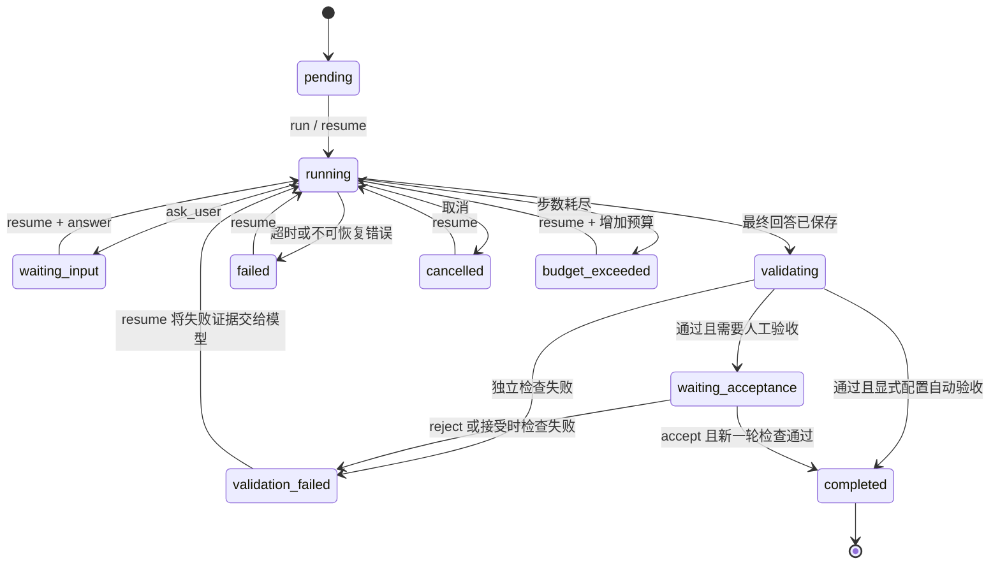

# TaskWeave v0.3 架构

## 模块职责

目录和依赖规则见 [模块边界与迁移](architecture/module-boundaries.md)，后续应用拆分见 [路线图](roadmap.md)。

| 模块 | 职责 |
| --- | --- |
| `apps/cli` | 参数、信号、终端及 JSON 输出、配置读取与依赖组装 |
| `core/task` | 任务初始化、稳定子任务身份与创建事件 |
| `core/workflow` | 定义校验、串行调度、attempt 有效性、返工与恢复 |
| `core/agent` | 统一执行循环、上下文、预算、暂停与检查点 |
| `core/tools` | 工具声明、运行时参数校验、调用与结果处理 |
| `core/validation` / `core/artifacts` | 验证策略、命令执行账本、证据和产物一致性 |
| `core/ports` | StateStore、WorkspacePort、ModelProvider、CheckRunner 接口 |
| `adapters/providers` | Chat Completions HTTP 适配与离线脚本 Provider |
| `adapters/storage/filesystem` | 工作区锁、JSON 快照、JSONL 事件、回执与配置读取 |
| `adapters/workspace/local` | 文件路径检查、文本读取与基于 hash 的原子更新 |
| `adapters/checks/process` | 固定命令的 cwd 检查、受限环境、取消与资源限制 |
| `evaluation` | 用例隔离、评测执行和逐例报告 |
| `contracts` | 不依赖 Node.js、业务服务或适配器的共享协议 |

`TaskEngine` 通过 `ModelProvider`、`StateStore` 和 `RuntimeServices` 接口运行，离线 Provider 和 HTTP Provider 返回相同的 `ModelTurn`。供应商协议隔离在适配器内，工具侧只接受解析后的调用名称和 JSON 参数。

## 一次运行

1. 创建任务，保存类型、目标、验收标准、模型标识和初始消息。
2. 执行器获得整个工作区的排他锁，装载快照；恢复时优先处理尚未完成的工具调用。
3. 检查执行时限、取消信号和累计模型调用次数。
4. 按字符预算整理模型上下文，保存 `model.started` 和已消耗步数，然后请求模型。
5. 校验模型返回值，将 assistant 消息与整批待执行调用保存，再执行工具。
6. 工具依次执行，结果写入回执，再追加 tool 消息并更新产物与子任务索引。
7. 模型请求更多工具就继续循环；返回最终回答则保存 `task.generated` 检查点，进入独立验证。
8. 执行配置命令、核对产物 hash、检查文件规则，保存验证结果。默认等待人工验收；显式自动验收策略通过时完成。

单轮最多接受 16 个工具调用。工具参数错误、未知工具和普通文件错误作为结构化 observation 反馈给模型，模型有机会纠正；模型协议错误、HTTP 错误和上下文超限会终止本次运行并保留检查点。

HTTP 适配器默认每次请求超时 90 秒，单次响应最多 2 MiB。对 429 和 5xx 最多尝试三次，等待时间受外层取消信号约束；其他错误不自动重试。网络异常可能已经在供应商侧消耗请求费用，恢复并不保证避免重复计费。

## 状态

进程异常退出时，快照可能仍为 `running`；确认旧进程退出并释放遗留锁后，可以 `resume`。`waiting_input` 保存待回答的 call ID、问题和未完成调用批次；回答会作为对应的 tool 结果插入，而非重新发送整段用户目标。

## 持久化顺序与故障窗口

工具回执键为 `任务ID + 累计步数 + 模型调用ID`。模型返回的全部调用先进入快照，然后才允许产生工具副作用。

| 故障位置 | 恢复行为 |
| --- | --- |
| 模型请求开始后、响应保存前 | 重试模型请求；已用步数保留，可能产生额外费用 |
| 待执行调用已保存、工具尚未执行 | 从该调用继续 |
| 文件替换完成、回执未保存 | 对同一目标内容的重复写入返回 `changed: false`；外部改动引发冲突 |
| 子任务创建完成、回执未保存 | 根据父任务与调用键推导稳定子任务 ID，返回已有任务 |
| 回执已保存、tool 消息未保存 | 读取回执，不再次执行工具；恢复消息与产物索引 |
| 事件追加完成、快照替换前 | 从旧快照继续；新事件序号大于日志尾部，不保证业务事件不重复 |
| JSONL 最后一次追加被截断 | 忽略未换行尾片段，下次追加前截掉该片段 |
| 生成回答已保存、尚未验证 | 恢复进入验证，不再次请求模型 |
| 命令 started 已保存、finished 未保存 | 返回 unknown，不自动重新执行 |
| 验证命令 finished 已保存、验证快照未完成 | 按验证 ID 复用命令结果 |

这些策略覆盖当前文件与创建任务工具的常见恢复窗口，不提供通用 exactly-once 语义。新增支付、发消息、远程修改等工具前，必须设计外部服务可识别的幂等键，不能直接沿用“失败就重试”。

快照使用同目录临时文件、文件 fsync 和 rename，避免读到部分 JSON；初版没有目录 fsync 和分布式存储一致性保证，主要面向本地进程中断恢复，不承诺突然断电后的完整持久性。

## 上下文与记忆

快照保留完整对话，模型上下文默认最多约 80,000 字符。始终保留初始指令与目标，以完整 assistant/tool 轮次为单位丢弃最早的历史，避免留下没有对应调用的工具结果；裁剪后插入产物和子任务索引。最新轮次仍然超预算会明确报错。

字符预算不能精确对应 tokenizer；早期决策只保存在完整快照中，不会自动变成语义记忆。模型可以按索引重新读取文件。后续可加入带证据引用的任务摘要及供应商 token 估算器。

## 并发与权限

初版对同一工作区采用单执行器，不在工具执行期间自动启动子任务。`list`、`show` 和 `events` 可以在执行期间读取已经落盘的记录。

文件工具拒绝符号链接和特定目录；配置后额外开放固定命令验证。命令使用最小继承环境、超时及输出限制，但宿主进程权限没有降级；被执行的生成代码同样具有宿主用户权限。这些机制不是隔离不可信租户的安全边界。若扩展为服务，需要进程或容器层限制文件、网络、资源和凭据访问，并添加身份与任务权限校验。

创建任务时保存规范化配置的 hash，恢复前核对配置；用户维护隐藏配置，模型只接收允许的命令名称。人工验收前重新检查文件和命令，避免基于旧证据接受产物。本地外部进程仍可能在检查后修改文件，未提供跨进程文件事务。

## 可扩展点

- 模型：实现 `ModelProvider`，补充协议契约测试，并保留稳定 Provider 标识。
- 工具：同时补齐 `core/tools` 中的 `TOOL_DEFINITIONS`、参数校验、权限规则和副作用恢复策略。
- 验收：增加领域 Schema、人工盲评与更细的证据类型，现有规则以结构和配置检查为主。
- 调度：在现有串行 DAG 上增加独立工作区、并行配额和合并机制；分布式执行需要任务所有权与租约。

v0.3 使用固定 DAG 串行调度，每个节点的 attempt 对应独立 Task 与回执；验证 ID 仅关联该 Task 的一轮独立检查。节点状态与 attempt 隔离、返工及持久化顺序见 [工作流说明](guides/workflows.md)。不把任务类型命名为多个独立 Agent。
