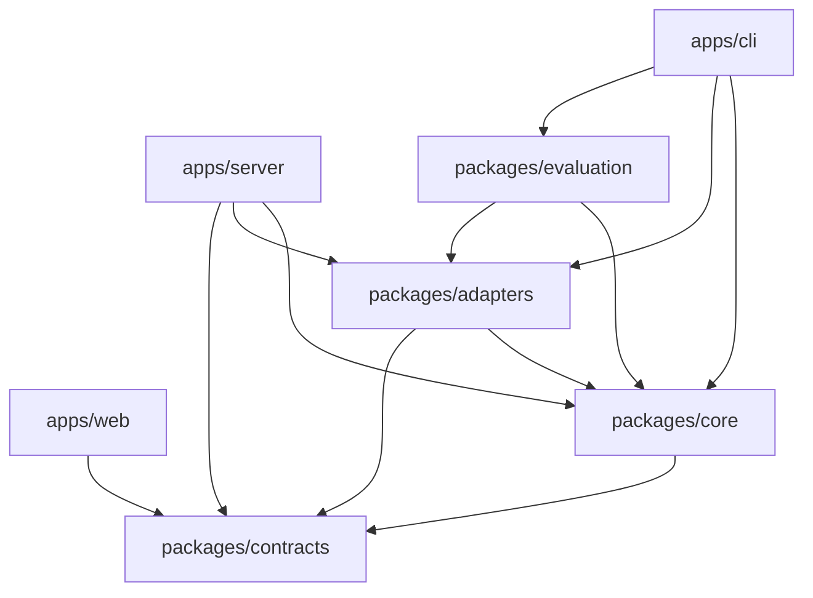

# 模块边界与目录迁移

目录整理始于 v0.3，保持本地单用户、固定 DAG 串行执行。v0.5 MR 1 新增只读 Server，MR 2 新增 Web，MR 3 新增静态回放；尚无独立 Runtime 或 Gateway。只在实现对应功能时建立应用目录。

## 工作区结构

```text
apps/cli/
  bin/taskweave.mjs       CLI 可执行入口
  src/main.ts            task / workflow 命令分发
  src/bootstrap.ts       操作者环境配置与本地依赖组装
  src/commands/          参数校验、信号与控制动作
  src/presentation/      帮助文本、终端和 JSON 输出
apps/server/src/
  app.ts                 只读路由、参数、HTTP 响应与错误
  queries/               任务、工作流、报告、事件及产物查询
  presentation/          对外展示字段白名单
  bootstrap.ts           组装只读存储与文件读取器
  server.ts / main.ts    本地 HTTP 适配与启动
  web.ts                 显式构建目录的只读静态托管
apps/web/src/
  data/                  同源查询、轮询、路由与事件合并
  pages/                 工作流/任务列表与工作流详情
  components/            DAG、指标、任务页签与时间线
  demo/                  API 视图录制、只读静态适配与回放控制
scripts/showcase/        固定脚本全流程、API 录制、静态托管与浏览器捕获
scripts/release/         已提交源码白名单归档与 SHA-256
  app.tsx / main.tsx      浏览器路由与 React 入口
packages/contracts/src/  http 展示模型、task、workflow、events、artifact、validation 协议
packages/core/src/
  task/                  任务类型、初始化、稳定身份
  workflow/              依赖图、串行编排、attempt 校验与恢复
  agent/                 模型协议、上下文、执行循环
  tools/                 工具声明、参数校验、调用
  validation/            规则、验收、命令账本
  artifacts/             产物内容一致性证据
  presets/               需求、测试、文档、代码等任务预设
  config/                配置模型、校验与指纹
  ports/                 存储、工作区、模型、命令接口
packages/adapters/src/
  providers/             兼容模型 HTTP 与固定脚本演示
  storage/filesystem/    快照、事件、回执、锁和操作者配置读取
  workspace/local/       本地文件访问、hash、冲突检测和原子更新
  checks/process/        子进程、cwd 校验、环境与资源限制
  runtime.ts             本地 RuntimeServices 实现组装
packages/evaluation/src/ 用例执行与逐例报告
packages/core/test/      无真实 I/O 的核心单元测试
tests/integration/      跨层行为、持久化、命令和恢复测试
tests/e2e/              CLI 与完整工作流测试
```

## 依赖方向

- contracts 无外部依赖，只包含共享协议及其简单判定。
- core 依赖 contracts；不导入 adapters、CLI、evaluation、文件系统、HTTP 或子进程。
- adapters 实现 core 的 ports，可以依赖 core 与 contracts。
- evaluation 组合 core 与 adapters，提供独立的离线评测宿主。
- Web 只依赖 contracts 展示类型，不导入 Node.js、core、adapters 或 Server；浏览器单独类型检查。
- Server 组合 contracts/core/adapters，使用 ReadStateStore 和只读文件端口；不依赖 CLI 或 evaluation。
- CLI 组合上述能力；参数、环境变量、进程信号和展示留在 CLI。

core 使用 Node.js crypto 生成身份与指纹，使用 path 做纯路径配置校验；这两个内置模块不读写外部资源。core 不承诺可直接运行在浏览器中。contracts 不依赖 Node.js，由 Web 复用。



`npm run check:boundaries` 检查 src 中的静态 import/export、固定字符串动态 import/require、跨包相对引用、依赖声明和公开入口；core 只允许上述两个 Node.js 内置模块。它约束源码依赖，不替代代码审查和宿主权限隔离。

## 能力接口

| 接口 | 核心使用方式 | 当前实现 |
| --- | --- | --- |
| StateStore | 锁、任务与工作流快照、事件、工具回执、检查记录 | TaskStore：文件系统 |
| WorkspacePort | 列出、读取、基于预期 hash 更新文件 | Workspace：本地文件 |
| ModelProvider | 请求模型并返回标准 ModelTurn | CompatibleProvider / DemoProvider |
| CheckRunner | 准备命令执行，再运行已准备的命令 | ProcessCheckRunner |
| RuntimeServices | 组装工作区工厂与命令实现 | localServices |

接口只覆盖已有功能，未提前加入消息队列、分布式租约、容器或数据库抽象。模型协议与内部 Task 检查点在 core，跨应用可共享的工作流、事件及产物描述在 contracts。HTTP API 使用 contracts/http 中单独定义的对外视图，不返回完整内部快照或默认公开事件中的原始 data。Server 的 FileStateReader 没有写入方法，读取 v1 数据而不加载模型和验证配置。详情见 [只读 API](../guides/read-api.md)。

## 必须保留的恢复顺序

`createTask` 在 core 中完成目标、预算、默认策略、提示词与稳定任务 ID 初始化，再调用 StateStore 保存事件和快照。调用方持有工作区锁；重放已有子任务或工作流任务时返回相同 ID。

`assertWorkflowTask` 从存储读取当前工作流，在同一锁范围内核对 run、node、attempt、task 和直接依赖的已验收输入版本。Agent 执行、工具调用和人工验收复用这条校验。文件更新仍发生在该锁的有效期内；移动业务规则没有替换为无锁的预检查。

命令调用顺序保持为：读取旧检查记录 → 校验执行目录并准备命令 → 检查取消 → 保存 started → 执行 → 保存 finished。准备阶段不能启动命令。已存在 started 而没有 finished 时返回 unknown，不调用 runner。验收前仍新建验证记录并执行新一轮检查。

文件工作区适配器负责路径限制、符号链接拒绝、当前内容 hash 冲突、权限位保留与原子替换。工具模块负责运行时参数和资源上限，并处理结构化 observation。

## 调用方迁移

在仓库根执行 `npm ci`，npm 会创建本地 workspace 链接。后端包仍由 tsx 执行 TypeScript，无需发布或构建；Web 通过 Vite 构建后由 Server 托管，见 [Web 指南](../guides/web.md)。

```ts
import { TaskEngine } from '@taskweave/core';
import { TaskStore, DemoProvider, localServices } from '@taskweave/adapters';

const store = await TaskStore.open('work');
const engine = new TaskEngine(localServices, store, new DemoProvider('document'));
const task = await engine.create({ kind: 'document', goal: '生成项目说明' });
await engine.run(task.id);
```

WorkflowEngine 和 TaskReviewer 的首个参数同样是 RuntimeServices。直接创建任务的内部调用使用 `createTask(store, input, provider)`，并在 store.withLock 中执行；存储类不再负责业务初始化或 attempt 校验。

旧 `src/*.ts` 内部路径已迁移，不保留同名转发树。仓库尚未发布库 SDK；如果已有脚本直接导入这些内部文件，需要改用明确的包入口。CLI 参数、退出码、环境变量、演示和评测命令保持兼容，根目录 bin/taskweave.mjs 为既有 --env-file 用法保留转发入口。

`.taskweave/tasks`、events、receipts、check-runs、workflows 与锁的文件布局、v1 编码、ID 和配置指纹算法保持兼容，不需要迁移数据。
