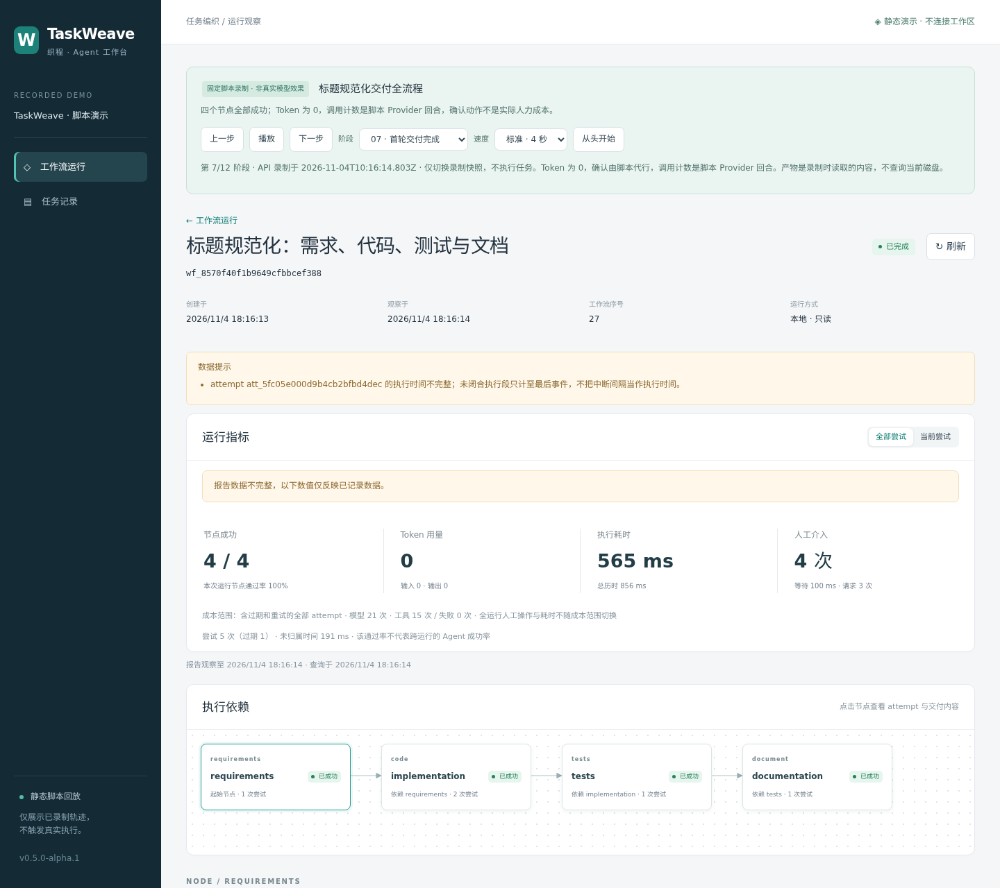

# 完整 Demo 与录制回放

本 Demo 用固定脚本实际运行 TaskWeave 引擎、文件工具、独立检查、问答、验收与返工，再通过只读 API 录制公开展示视图。**没有调用真实模型，内容由脚本预设，人工确认由脚本代行。** Token 为 0；报告中的模型调用次数是固定 Provider 的回合数，人工等待不是实际人力成本。

## 无需模型和工作区的静态演示

在仓库根目录运行，Node.js 20.19+（22 系列须 22.12+）：

```bash
npm ci --include=dev
npm run web:demo:build
npm run showcase:serve
```

在开发机打开 `http://127.0.0.1:4311/`。页面自动进入演示工作流，可播放、暂停、调速、逐步前进、倒退、选择阶段、从头开始，也可浏览任务、历史 attempt 和页签。URL 中 `?frame=6` 是从 0 开始的录制阶段，可与 hash 路由一起分享。

`apps/web/dist-demo/` 是独立静态站点，可部署至任意支持 ESM 的 HTTP 静态托管根目录或子目录，无需 TaskWeave API、模型 Key 或 `.taskweave` 数据。该构建使用相对资源地址；不能通过 `file://` 直接打开。尚未部署到外部站点。

运行 `npm run web:build` 则生成真实工作区的 Web 至 `apps/web/dist/`，其入口不包含 Demo 数据。两个构建目录独立，不自动互相切换。静态演示不会因为记录缺失而回退到真实 API，也不能用于查看自己的工作区。

## 12 个录制阶段

| 阶段 | 行为与可核对的结果 |
| --- | --- |
| 01 创建 | 固定 DAG：requirements → implementation → tests → documentation |
| 02 需求待确认 | 需求 JSON 通过结构检查，停在人工门禁 |
| 03 验证失败 | 故意交付错误函数；实际 Node assert 检查失败，下游阻塞 |
| 04 显式重试 | 旧代码 attempt 过期，创建新身份，保留历史消耗 |
| 05 等待输入 | 修正代码通过 smoke，生成测试通过 node:test；文档询问语言 |
| 06 文档待验收 | 展示绑定的 doc-style、摘要、交接和验证记录 |
| 07 首轮完成 | 4/4 节点成功，区分当前/全部 attempt 的统计范围 |
| 08 上游返工 | 需求返工使下游结果传递失效，工作流不再保持 completed |
| 09 历史文件变化 | 新需求覆盖同一路径；旧 attempt 的产物读取返回真实 409 |
| 10 新交接执行 | 新 attempt 绑定新的来源身份，代码与测试重新验证 |
| 11 再次验收 | 新文档不能沿用旧 attempt 的验收决定 |
| 12 最终完成 | 再次完成 4 个节点，总计 9 个 attempt，其中包含重试和过期记录 |

回放的是操作边界处的完整 API 快照，不是逐 Token 或逐事件的实时执行仿真。每次切换阶段都会重建查询与事件游标，倒退不会混入未来的任务或时间线。自动播放在隐藏标签页中暂停推进，结束后停止。

录制中的产物内容是**录制当时**经过 hash 核对的 API 响应；当前磁盘的同名文件变化不会修改已打包快照。这不是为真实任务增加了历史产物版本库。错误响应也被录制，旧 hash 不匹配时仍展示 409，不能用其他阶段的内容填补。

报告保留原始 warnings：失败/返工后的部分时间片段可能标记不完整，不把未知时间补成完整成功。全部/当前 attempt 只改变成本范围；人工操作和耗时仍按整个运行计算。

## 自己重新录制

```bash
npm run showcase:record
# 输出：.cache/showcase/session.json，另有新的 .cache/showcase/work-<timestamp> 工作区

# 显式生成可提交的展示数据；会覆盖该指定输出文件
npm run showcase:record -- --output apps/web/src/demo/recording.json
npm run web:demo:build
```

录制器会实际执行示例中配置的 Node assert 与 node:test；所有写入都在新工作区，目录已存在就拒绝，不清理或复用用户数据。它不读取 `.env`、不实例化兼容模型 Provider、不监听端口。重复运行可复现流程和状态，但 UUID、时间、检查耗时等不保证逐字节相同。

样例定义位于 `examples/showcase/`，Provider 位于 `scripts/showcase/provider.ts`，录制器调用真实 `WorkflowEngine` 与 `/api/v1` 处理器；没有另造一套业务状态机。脚本使用预设答案，摘要为引擎的 extractive 回退；Skill 绑定展示不证明模型理解了 Skill。

## 截图、录屏与浏览器验证



[独立验证失败截图](../media/validation.png) · [历史产物变化截图](../media/history.png) · [移动端截图](../media/mobile.png) · [完整回放录屏（WebM）](../media/walkthrough.webm) · [浏览器捕获记录](../media/capture.json)

这些文件来自真实 Chromium 对静态生产构建的渲染，不是设计稿。捕获脚本用 pipe 控制 Chromium，并在内存中提供已构建资源，没有启动监听端口、连接真实 API 或请求模型。覆盖桌面、移动端溢出检查、12 阶段自动播放及页面错误检查；没有验证真实 Server 的 TCP 监听。

重新捕获需要单独安装浏览器，默认不会在 npm ci 或 npm test 时下载或启动浏览器：

```bash
# 浏览器文件限于当前仓库缓存目录，不安装系统依赖
PLAYWRIGHT_BROWSERS_PATH="$PWD/.cache/browsers" npx playwright install chromium
PLAYWRIGHT_BROWSERS_PATH="$PWD/.cache/browsers" npm run showcase:capture
```

原理与 API 参考 [Playwright 网络拦截](https://playwright.dev/docs/network)、[截图](https://playwright.dev/docs/screenshots)；静态部署参考 [Vite 构建](https://vite.dev/guide/build.html)。录屏和截图由脚本生成，重新录制数据后需重新构建和捕获，不能沿用旧图声称验证了新数据。

五分钟讲解顺序见 [演示讲稿](presentation.md)，公开源码交付见 [开源发布说明](../open-source.md)。
